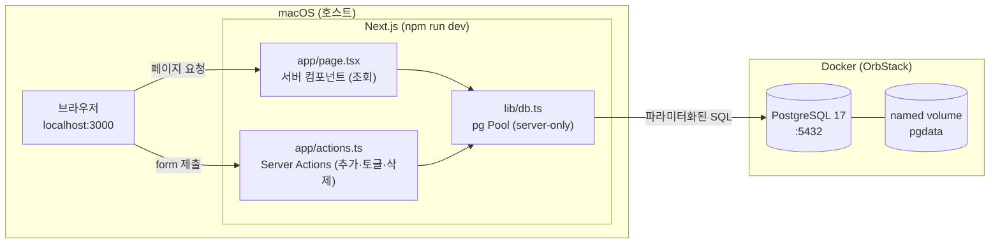

# My Todo — 제품 요구사항 문서 (PRD)

> 문서 버전: 1.0 · 작성일: 2026-10-29 · 단계: 1단계 (설계)

---

## 1. 개요

### 1.1 프로젝트 소개

**My Todo**는 브라우저에서 할 일을 등록하고 관리하는 **로컬 웹 애플리케이션**입니다.
교육 과제용이라 **최소 기능(CRUD)** 만 구현합니다. 그 대신 다음 내용을 제대로 익히는 것이 목표입니다.

- Next.js App Router의 **서버 컴포넌트**로 데이터를 조회하는 방법
- **Server Actions**로 별도 API 없이 데이터를 변경하는 방법
- ORM 없이 `pg`(node-postgres)와 **파라미터화된 SQL**로 DB를 다루는 방법
- Docker로 띄운 PostgreSQL에 데이터를 **영구 저장**하는 방법

### 1.2 목표

| # | 목표 | 성공 기준 |
|---|---|---|
| G1 | 할 일 CRUD 제공 | 추가 · 조회 · 완료 토글 · 삭제가 모두 동작 |
| G2 | 데이터 영구 저장 | 새로고침, Next.js 재시작, Docker 컨테이너 재시작 후에도 데이터 유지 |
| G3 | 안전한 DB 접근 | DB 접속은 서버 코드에서만, 비밀번호는 환경변수, SQL은 모두 파라미터화 |
| G4 | 이전 가능성 | 같은 SQL 스크립트로 Supabase PostgreSQL에 동일한 테이블 생성 가능 |

### 1.3 비목표 (이번 과제에서 하지 않는 것)

- 회원가입 / 로그인, 사용자별 데이터 분리
- 별도 REST API (`app/api/*` Route Handler 포함), Express · NestJS · Spring Boot 같은 별도 백엔드
- 외부 API 연동
- 태그, 카테고리, 검색, 알림, 파일 첨부, 마감일, 정렬 옵션, 수정(제목 변경)
- Supabase 연동 및 Render 배포 (설계만 이전 가능하게 해 두고 실제 이전은 하지 않음)
- Redux · Zustand · React Query 같은 상태 관리 라이브러리, ORM(Prisma, Drizzle 등)

---

## 2. 사용자와 사용 시나리오

**사용자**: 내 Mac에서 앱을 실행하는 교육생 1명 (로그인 없음, 모든 할 일 공용)

| 시나리오 | 흐름 |
|---|---|
| 할 일 추가 | 입력창에 "장보기" 입력 → [추가] 클릭 → 목록 맨 위에 "장보기"가 나타남 |
| 목록 확인 | 페이지 접속 → 저장된 할 일이 최신순으로 표시됨 |
| 완료 처리 | 체크박스 클릭 → 제목에 취소선이 표시됨 / 다시 클릭하면 해제 |
| 삭제 | [삭제] 클릭 → 해당 할 일이 목록에서 사라짐 |
| 영속성 확인 | 브라우저 새로고침, `npm run dev` 재시작 → 데이터가 그대로 남아 있음 |

---

## 3. 기능 요구사항

### FR-1. 할 일 추가 (Create)

| 항목 | 내용 |
|---|---|
| 입력 | 제목(title) 텍스트 1개 |
| 검증 | 앞뒤 공백을 제거(trim)한 뒤 **빈 문자열이면 저장하지 않음**, **200자 초과 시 저장하지 않음** |
| 검증 위치 | ① 브라우저: `<input required maxLength={200}>` ② 서버: Server Action에서 다시 검사 ③ DB: `CHECK` 제약조건 (3중 방어) |
| 처리 | Server Action이 `INSERT ... VALUES ($1)` 실행. `id`, `is_completed`, `created_at`은 DB 기본값 사용 |
| 결과 | 성공 시 입력창 비우고 목록 갱신 (`revalidatePath('/')`) |

### FR-2. 할 일 목록 조회 (Read)

| 항목 | 내용 |
|---|---|
| 처리 | 서버 컴포넌트(`app/page.tsx`)에서 직접 `SELECT` 실행 |
| 정렬 | `created_at DESC` (최신 항목이 위) |
| 표시 정보 | 완료 여부(체크박스), 제목, 삭제 버튼 |
| 빈 상태 | 할 일이 없으면 "할 일이 없습니다" 안내 문구 표시 |

### FR-3. 완료 / 미완료 변경 (Update)

| 항목 | 내용 |
|---|---|
| 입력 | 할 일 `id` |
| 처리 | `UPDATE todos SET is_completed = NOT is_completed WHERE id = $1` |
| 표시 | 완료된 항목은 취소선 + 흐린 색상 |

### FR-4. 할 일 삭제 (Delete)

| 항목 | 내용 |
|---|---|
| 입력 | 할 일 `id` |
| 처리 | `DELETE FROM todos WHERE id = $1` (복구 기능 없음) |

---

## 4. 비기능 요구사항

| ID | 구분 | 요구사항 |
|---|---|---|
| NFR-1 | 영속성 | PostgreSQL 데이터는 Docker **named volume**에 저장해 컨테이너를 지웠다 다시 만들어도 유지 |
| NFR-2 | 보안 | DB 접속 정보는 `.env`의 `DATABASE_URL`로 관리하고 Git에 커밋하지 않음 (`.env.example`만 커밋) |
| NFR-3 | 보안 | DB 모듈은 `import 'server-only'`로 보호해 클라이언트 번들에 포함되지 않게 함 |
| NFR-4 | 보안 | 모든 SQL은 `$1, $2` 형식의 **파라미터화된 쿼리** 사용. 문자열 이어붙이기 금지 |
| NFR-5 | 이식성 | 표준 PostgreSQL SQL만 사용 (확장 설치 불필요). Supabase에서 같은 스크립트로 재생성 가능 |
| NFR-6 | 단순성 | 런타임 의존성은 `next`, `react`, `react-dom`, `pg` 정도로 최소화 |
| NFR-7 | 실행 환경 | Docker에는 PostgreSQL만 실행. Next.js는 macOS에서 `npm run dev`로 직접 실행 |

---

## 5. 기술 스택

| 영역 | 선택 | 비고 |
|---|---|---|
| 프레임워크 | Next.js 16.4 (App Router, Turbopack) | 서버 컴포넌트 + Server Actions, Cache Components 기본 활성 |
| 언어 / UI | React + TypeScript | |
| 스타일 | Tailwind CSS (또는 순수 CSS) | `create-next-app` 기본 옵션 사용 |
| 데이터 변경 | Next.js Server Actions | 별도 REST API 없음 |
| DB | PostgreSQL 17 (Docker Compose) | `postgres:17` 공식 이미지 |
| DB 드라이버 | `pg` (node-postgres) + `@types/pg` | ORM 사용 안 함 |
| 개발 환경 | macOS (Apple Silicon), Node.js 24, OrbStack(Docker) | 0단계에서 확인 완료 |

---

## 6. 아키텍처

### 6.1 구성도



### 6.2 데이터 흐름

**조회 (Read)**
1. 브라우저가 `/` 요청
2. 서버 컴포넌트 `page.tsx`가 `lib/db.ts`의 `pool.query('SELECT ...')` 실행
3. 결과를 HTML로 렌더링해 브라우저에 전송 (DB 접속 정보는 브라우저에 절대 전달되지 않음)

**변경 (Create / Update / Delete)**
1. 사용자가 `<form action={serverAction}>` 제출
2. Next.js가 서버에서 Server Action 함수 실행
3. Server Action이 입력값 검증 → 파라미터화된 SQL 실행
4. `revalidatePath('/')` 호출 → 서버 컴포넌트가 다시 렌더링되어 최신 목록 표시

### 6.3 아키텍처 규칙

| 규칙 | 적용 방법 |
|---|---|
| REST API 금지 | `app/api/` 디렉터리를 만들지 않음 |
| 조회는 서버 컴포넌트 | `page.tsx`는 `async` 서버 컴포넌트, `'use client'` 없음 |
| 변경은 Server Actions | `actions.ts` 최상단에 `'use server'` |
| DB는 서버에서만 | `lib/db.ts` 최상단에 `import 'server-only'` |
| 클라이언트 컴포넌트 최소화 | 필요할 때만 작은 컴포넌트에 `'use client'` (예: 제출 후 입력창 초기화) |
| DB 조회는 `<Suspense>` 안에서 | Next.js 16은 Cache Components가 기본으로 켜져 있어, 캐시하지 않는 DB 조회 컴포넌트를 `<Suspense>`로 감싸야 함 (안 하면 빌드 오류) |

---

## 7. 화면 설계

단일 페이지(`/`)로 구성합니다.

```
┌──────────────────────────────────────────┐
│  My Todo                                 │
│                                          │
│  ┌──────────────────────────┐ ┌───────┐  │
│  │ 할 일을 입력하세요          │ │ 추가  │  │
│  └──────────────────────────┘ └───────┘  │
│                                          │
│  ☐  장보기                       [삭제]  │
│  ☑  ~~과제 제출~~                [삭제]  │
│  ☐  운동하기                     [삭제]  │
│                                          │
│  총 3개 · 완료 1개                        │
└──────────────────────────────────────────┘
```

---

## 8. 환경 변수

| 변수 | 예시 | 설명 |
|---|---|---|
| `DATABASE_URL` | `postgresql://todo:<비밀번호>@localhost:5432/my_todo` | Next.js가 DB에 접속할 때 사용 |
| `POSTGRES_USER` | `todo` | Docker 컨테이너 초기 사용자 |
| `POSTGRES_PASSWORD` | (직접 지정) | Docker 컨테이너 초기 비밀번호 |
| `POSTGRES_DB` | `my_todo` | Docker 컨테이너 초기 DB 이름 |

- `.env` → 실제 값. Docker Compose와 Next.js가 **같은 파일을 함께 읽음**. **Git 제외** (`.gitignore`에 등록)
- `.env.example` → 값 없이 변수 이름만 적어 **Git에 커밋**
- 파일을 `.env` 하나로 합친 이유: Docker Compose는 `.env`만 자동으로 읽고, Next.js도 `.env`를 읽기 때문입니다.
- Supabase로 이전할 때는 `DATABASE_URL`만 Supabase 접속 문자열로 바꾸면 됩니다.

---

## 9. 예상 프로젝트 폴더 구조

```
my-todo-app/
├── PRD.md                    # 이 문서
├── docs/
│   └── DB_DESIGN.md          # DB 설계 문서
├── db/
│   └── init.sql              # todos 테이블 생성 SQL (Docker 초기화 + Supabase 공용)
├── docker-compose.yml        # PostgreSQL 컨테이너만 정의
├── .env.example              # 환경변수 템플릿 (커밋 O)
├── .env                      # 실제 값, Docker·Next.js 공용 (커밋 X)
├── .gitignore
├── package.json
├── tsconfig.json
├── next.config.ts
└── src/
    ├── app/
    │   ├── layout.tsx        # 공통 레이아웃
    │   ├── page.tsx          # 목록 조회 (서버 컴포넌트)
    │   ├── actions.ts        # Server Actions: addTodo, toggleTodo, deleteTodo
    │   └── globals.css
    ├── components/
    │   ├── TodoForm.tsx      # 입력 폼 (필요 시 'use client')
    │   └── TodoItem.tsx      # 할 일 한 줄 (체크박스 + 삭제)
    └── lib/
        ├── db.ts             # pg Pool 생성 (server-only)
        └── types.ts          # Todo 타입 정의
```

> `create-next-app`의 `--src-dir` 옵션 사용을 가정했습니다. 옵션을 다르게 고르면 `src/` 없이 루트에 `app/`이 생길 수 있습니다.

---

## 10. 단계별 구현 계획

| 단계 | 작업 | 산출물 | 완료 기준 |
|---|---|---|---|
| **1단계** | PRD · DB 설계 (현재) | `PRD.md`, `docs/DB_DESIGN.md` | 문서 검토 완료 |
| **2단계** | DB 환경 구성 | `docker-compose.yml`, `db/init.sql`, `.env.example`, `.gitignore` | `docker compose up -d` 후 `todos` 테이블 생성 확인 |
| **3단계** | Next.js 프로젝트 생성 | `create-next-app` 결과물, `pg` 설치 | `npm run dev` 후 기본 페이지 표시 |
| **4단계** | DB 연결 모듈 | `src/lib/db.ts`, `src/lib/types.ts` | 서버에서 `SELECT 1` 성공 |
| **5단계** | 조회 (Read) | `page.tsx` | DB에 직접 넣은 데이터가 화면에 표시 |
| **6단계** | 추가 (Create) | `actions.ts` `addTodo`, `TodoForm.tsx` | 추가 후 목록 즉시 갱신, 빈 제목 거부 |
| **7단계** | 토글 · 삭제 (Update · Delete) | `toggleTodo`, `deleteTodo`, `TodoItem.tsx` | 체크/해제, 삭제 동작 |
| **8단계** | 검증 및 정리 | `README.md` | 새로고침 · 앱 재시작 · 컨테이너 재시작 후 데이터 유지 확인 |

---

## 11. 인수 기준 (Acceptance Criteria)

> 2026-10-29 8단계에서 모두 확인 완료.

- [x] 제목을 입력하고 추가하면 목록 맨 위에 나타난다.
- [x] 공백만 입력하면 저장되지 않는다.
- [x] 201자 이상은 저장되지 않는다.
- [x] 체크박스를 누르면 완료 ↔ 미완료가 바뀌고, 새로고침해도 유지된다.
- [x] 삭제를 누르면 목록에서 사라지고, 새로고침해도 다시 나타나지 않는다.
- [x] `npm run dev`를 재시작해도 데이터가 유지된다.
- [x] `docker compose down` 후 `up`을 해도 데이터가 유지된다 (`-v` 옵션 제외).
- [x] 프로젝트에 `app/api/` 디렉터리가 없다.
- [x] 브라우저 개발자 도구의 JS 번들에 DB 접속 정보가 없다.
- [x] 소스 코드의 모든 SQL이 `$1` 형식의 파라미터를 사용한다.
