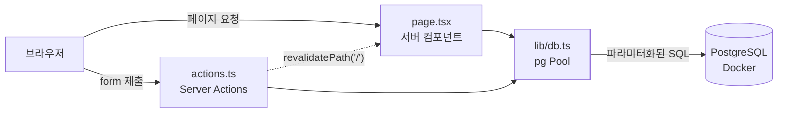

# My Todo

브라우저에서 할 일을 추가 · 조회 · 완료 처리 · 삭제하는 교육용 Todo 웹 애플리케이션입니다.
데이터는 Docker로 띄운 PostgreSQL에 저장되어, 새로고침하거나 앱 · DB를 재시작해도 유지됩니다.

- 요구사항: [PRD.md](PRD.md)
- DB 설계: [docs/DB_DESIGN.md](docs/DB_DESIGN.md)

## 기술 스택

| 영역 | 사용 기술 |
|---|---|
| 프레임워크 | Next.js 16 (App Router, Turbopack) |
| UI | React 19 + TypeScript, Tailwind CSS v4 |
| 데이터 변경 | Next.js Server Actions (별도 REST API 없음) |
| DB | PostgreSQL 17 (Docker Compose) |
| DB 드라이버 | `pg` (node-postgres), ORM 없음 |

## 사전 준비

- Node.js 20 이상 (개발 환경: Node.js 24)
- Docker + Docker Compose (Docker Desktop 또는 OrbStack)
- 5432 포트(PostgreSQL)와 3000 포트(Next.js)가 비어 있어야 합니다.

## 실행 방법

### 1. 환경변수 파일 만들기

```bash
cp .env.example .env
```

`.env`를 열어 `POSTGRES_PASSWORD`에 비밀번호를 정하고, `DATABASE_URL`의 `<비밀번호>` 자리에도 같은 값을 넣습니다.
`.env`는 Docker Compose와 Next.js가 함께 읽으며, Git에는 커밋되지 않습니다.

### 2. PostgreSQL 시작

```bash
docker compose up -d --wait
```

처음 실행할 때 [db/init.sql](db/init.sql)이 자동으로 실행되어 `todos` 테이블이 만들어집니다.

### 3. 패키지 설치

```bash
npm install
```

### 4. 개발 서버 시작

```bash
npm run dev
```

브라우저에서 http://localhost:3000 을 엽니다.

## 자주 쓰는 명령

| 하는 일 | 명령 |
|---|---|
| DB 시작 | `docker compose up -d --wait` |
| DB 중지 (데이터 유지) | `docker compose down` |
| DB 상태 확인 | `docker compose ps` |
| DB에 직접 접속 | `docker compose exec db psql -U todo -d my_todo` |
| 개발 서버 | `npm run dev` |
| 프로덕션 빌드 / 실행 | `npm run build` → `npm start` |
| 코드 검사 | `npm run lint` |

> ⚠️ `docker compose down -v`는 볼륨까지 지워 **모든 데이터가 삭제**됩니다.
> `init.sql`을 고쳐서 테이블을 다시 만들어야 할 때만 사용하세요.

## 프로젝트 구조

```
my-todo-app/
├── PRD.md                    # 요구사항 문서
├── docs/DB_DESIGN.md         # DB 설계 문서
├── db/init.sql               # todos 테이블 생성 SQL (Docker · Supabase 공용)
├── docker-compose.yml        # PostgreSQL 컨테이너 정의
├── .env.example              # 환경변수 템플릿 (실제 값은 .env)
└── src/
    ├── app/
    │   ├── layout.tsx        # 공통 레이아웃
    │   ├── page.tsx          # 목록 조회 (서버 컴포넌트)
    │   └── actions.ts        # Server Actions: addTodo, toggleTodo, deleteTodo
    ├── components/
    │   ├── TodoForm.tsx      # 입력 폼 (유일한 클라이언트 컴포넌트)
    │   └── TodoItem.tsx      # 할 일 한 줄: 완료 토글 · 삭제 (서버 컴포넌트)
    └── lib/
        ├── db.ts             # pg Pool (server-only)
        └── types.ts          # Todo 타입
```

## 동작 방식



- **조회**: `page.tsx`가 서버에서 `SELECT`를 실행하고 결과를 HTML로 보냅니다. DB 접속 정보는 브라우저로 가지 않습니다.
- **변경**: 버튼과 입력 폼은 `<form action={Server Action}>`입니다. 서버에서 SQL을 실행한 뒤 `revalidatePath('/')`로 목록을 다시 그립니다.
- **Suspense**: Next.js 16은 Cache Components가 기본으로 켜져 있어, DB 조회 컴포넌트를 `<Suspense>`로 감쌉니다. 제목 · 입력창은 미리 만들어 두고 목록만 요청마다 새로 조회합니다(빌드 결과의 `◐ Partial Prerender`).

## 보안 · 품질 규칙

| 규칙 | 적용 위치 |
|---|---|
| DB 접속은 서버에서만 | `lib/db.ts`의 `import "server-only"` — 클라이언트에서 import 하면 컴파일 오류 |
| 비밀번호는 환경변수로 | `.env`의 `DATABASE_URL` (Git 제외) |
| SQL Injection 방지 | 모든 쿼리를 `pool.query("... $1", [값])` 형식으로 실행 |
| 빈 제목 방지 (3중) | 브라우저 `required` → Server Action trim 검사 → DB `CHECK` 제약 |
| 잘못된 id 방지 | Server Action에서 UUID 형식 검사 후 실행 |

## Supabase로 이전하려면 (참고)

1. Supabase SQL Editor에서 [db/init.sql](db/init.sql)을 그대로 실행합니다.
2. `.env`의 `DATABASE_URL`을 Supabase 접속 문자열로 바꿉니다 (SSL 필요).

앱 코드는 바꿀 필요가 없습니다. 자세한 내용과 주의점(RLS, SSL)은 [docs/DB_DESIGN.md](docs/DB_DESIGN.md) 9절을 참고하세요.

## 문제 해결

| 증상 | 확인할 것 |
|---|---|
| `DATABASE_URL 환경변수가 없습니다` 오류 | 프로젝트 루트에 `.env`가 있는지 확인 |
| DB 연결 실패 (`ECONNREFUSED`) | `docker compose ps`로 컨테이너가 `healthy`인지 확인 |
| 비밀번호 인증 실패 | `.env`의 비밀번호를 컨테이너 생성 **후에** 바꾼 경우, 기존 볼륨에는 예전 비밀번호가 남아 있음 |
| `port is already allocated` | 5432 포트를 다른 PostgreSQL이 쓰고 있는지 확인 (`lsof -i :5432`) |
