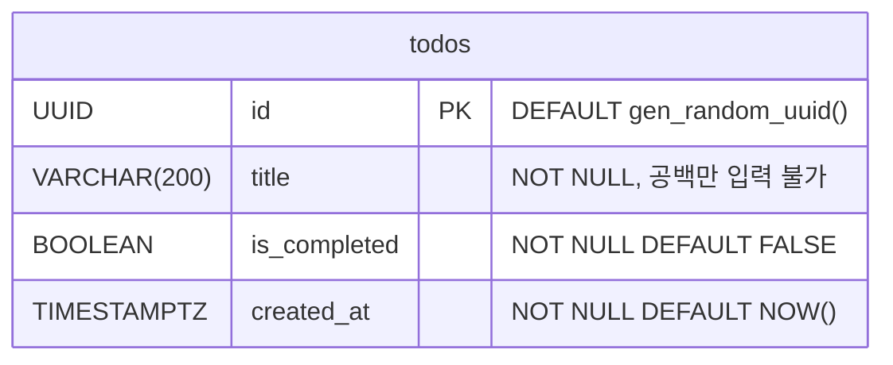

# My Todo — 데이터베이스 설계

> 문서 버전: 1.0 · 작성일: 2026-10-29 · 대상: PostgreSQL 17 (Docker) → 이후 Supabase PostgreSQL

---

## 1. 설계 원칙

| 원칙 | 설명 |
|---|---|
| **테이블 1개** | 로그인과 사용자 구분이 없으니 `todos` 테이블 하나면 충분합니다. |
| **DB가 기본값을 책임짐** | `id`, `is_completed`, `created_at`은 DB가 채웁니다. 앱은 `title`만 넘기면 됩니다. |
| **표준 SQL만 사용** | 확장(extension) 설치 없이 PostgreSQL 내장 기능만 씁니다. Supabase에서도 같은 스크립트가 그대로 동작합니다. |
| **DB에서도 검증** | 빈 제목은 앱에서 막지만, DB에도 `CHECK` 제약을 걸어 잘못된 데이터가 들어올 길을 막습니다. |

---

## 2. ERD



> 테이블이 하나라 관계선은 없습니다. 나중에 `users` 테이블이 생기면 `todos.user_id → users.id` 관계가 추가되는 구조입니다 (이번 과제 범위 아님).

---

## 3. 테이블 정의: `todos`

| 컬럼 | 타입 | NULL | 기본값 | 제약 | 설명 |
|---|---|---|---|---|---|
| `id` | `UUID` | NOT NULL | `gen_random_uuid()` | PRIMARY KEY | 할 일 고유 식별자 |
| `title` | `VARCHAR(200)` | NOT NULL | — | `CHECK (btrim(title) <> '')` | 할 일 제목 (1~200자) |
| `is_completed` | `BOOLEAN` | NOT NULL | `FALSE` | — | 완료 여부 |
| `created_at` | `TIMESTAMPTZ` | NOT NULL | `NOW()` | — | 생성 시각 (목록 정렬 기준) |

### 3.1 컬럼별 설계 이유

#### `id` — `UUID` + `gen_random_uuid()`

- **왜 UUID인가?** `SERIAL`(1, 2, 3…) 같은 순번 ID는 URL이나 폼에 노출되면 전체 개수나 다른 항목 ID를 쉽게 추측할 수 있습니다. UUID는 추측이 어렵고, 나중에 다른 DB(Supabase)로 데이터를 옮겨도 ID가 충돌하지 않습니다.
- **왜 DB에서 생성하나?** 앱이 ID를 만들지 않아도 되니 `INSERT` 코드가 단순해지고, 어떤 경로로 데이터가 들어와도 ID 형식이 같습니다.
- **확장이 필요 없나?** `gen_random_uuid()`는 PostgreSQL 13부터 **내장 함수**입니다. 예전처럼 `pgcrypto`나 `uuid-ossp` 확장을 설치할 필요가 없습니다. Supabase도 PostgreSQL 15 이상이라 그대로 동작합니다.

#### `title` — `VARCHAR(200) NOT NULL` + `CHECK`

- **왜 `VARCHAR(200)`인가?** 할 일 제목은 짧은 문장입니다. 길이 상한을 두면 비정상적으로 긴 입력을 DB 단계에서 거부할 수 있습니다. (PostgreSQL에서 `VARCHAR(n)`과 `TEXT`의 성능 차이는 없으니, 상한이 필요하면 `VARCHAR(n)`을 쓰면 됩니다.)
- **왜 `NOT NULL`만으로는 부족한가?** `NOT NULL`은 `NULL`만 막습니다. 빈 문자열 `''`이나 공백 `'   '`은 통과합니다. 그래서 `CHECK (btrim(title) <> '')`로 **앞뒤 공백을 지운 결과가 빈 문자열이면 거부**합니다.
- **3중 방어**: 브라우저(`required`, `maxLength`) → Server Action(trim 후 검사) → DB(`CHECK`, `VARCHAR(200)`). 앞 단계가 뚫려도 DB가 마지막으로 막아 줍니다.

#### `is_completed` — `BOOLEAN NOT NULL DEFAULT FALSE`

- 상태가 "완료 / 미완료" 두 가지뿐이니 `BOOLEAN`이 가장 정확합니다.
- `NOT NULL`을 걸어 "알 수 없음(NULL)"이라는 세 번째 상태가 생기지 않게 합니다.
- 새 할 일은 당연히 미완료이므로 기본값은 `FALSE`입니다.

#### `created_at` — `TIMESTAMPTZ NOT NULL DEFAULT NOW()`

- **왜 `TIMESTAMPTZ`인가?** `TIMESTAMP`(시간대 없음)는 서버 시간대가 바뀌면 의미가 달라집니다. `TIMESTAMPTZ`는 내부적으로 UTC로 저장하고, 조회할 때 접속한 세션의 시간대로 바꿔 보여 줍니다. Docker(기본 UTC)와 Supabase(UTC) 사이를 옮겨도 시각이 정확히 유지됩니다.
- 목록을 **최신순으로 정렬**하는 기준 컬럼입니다.
- UUID는 순서가 없기 때문에 "먼저 만든 순서"를 알려면 이 컬럼이 꼭 필요합니다.

### 3.2 이번에 넣지 않은 컬럼

| 컬럼 | 넣지 않은 이유 |
|---|---|
| `updated_at` | 제목 수정 기능이 없고, 자동 갱신하려면 트리거가 필요해 과제 범위를 넘습니다. |
| `user_id` | 로그인 / 사용자 구분이 비목표입니다. |
| `due_date`, `priority`, `tag` | 마감일 · 우선순위 · 태그 기능이 비목표입니다. |

---

## 4. 인덱스

| 인덱스 | 대상 | 이유 |
|---|---|---|
| `todos_pkey` | `id` | PRIMARY KEY를 선언하면 자동 생성됩니다. 토글 · 삭제 시 `WHERE id = $1` 조회에 사용됩니다. |
| `todos_created_at_idx` | `created_at DESC` | 목록 조회의 `ORDER BY created_at DESC`에 사용됩니다. |

> 교육용으로 데이터가 수십 건 수준이면 인덱스가 없어도 차이가 없습니다. 하지만 "정렬 기준 컬럼에는 인덱스를 둔다"는 습관을 보여 주기 위해 포함했습니다.

---

## 5. DDL (테이블 생성 SQL)

2단계에서 `db/init.sql`로 저장해 사용할 예정입니다.
Docker 컨테이너가 **처음 만들어질 때** 자동 실행되고, Supabase에서는 **SQL Editor에 그대로 붙여 넣어** 실행하면 됩니다.

```sql
-- My Todo: todos 테이블
-- PostgreSQL 13+ 표준 SQL (확장 설치 불필요) · Docker PostgreSQL / Supabase 공용

CREATE TABLE IF NOT EXISTS todos (
    id           UUID         PRIMARY KEY DEFAULT gen_random_uuid(),
    title        VARCHAR(200) NOT NULL,
    is_completed BOOLEAN      NOT NULL DEFAULT FALSE,
    created_at   TIMESTAMPTZ  NOT NULL DEFAULT NOW(),

    CONSTRAINT todos_title_not_blank CHECK (btrim(title) <> '')
);

CREATE INDEX IF NOT EXISTS todos_created_at_idx
    ON todos (created_at DESC);
```

- `IF NOT EXISTS`를 붙여 여러 번 실행해도 오류가 나지 않습니다.
- 제약조건에 `todos_title_not_blank`라는 이름을 붙여, 위반 시 오류 메시지에서 원인을 바로 알 수 있습니다.

---

## 6. 애플리케이션에서 사용할 쿼리

모든 쿼리는 `$1` 형식의 **파라미터화된 쿼리**로 실행합니다.

| 기능 | SQL | 파라미터 |
|---|---|---|
| 목록 조회 | `SELECT id, title, is_completed, created_at FROM todos ORDER BY created_at DESC` | 없음 |
| 추가 | `INSERT INTO todos (title) VALUES ($1)` | `$1` = trim한 제목 |
| 완료 토글 | `UPDATE todos SET is_completed = NOT is_completed WHERE id = $1` | `$1` = id |
| 삭제 | `DELETE FROM todos WHERE id = $1` | `$1` = id |

### 6.1 SQL Injection과 파라미터화된 쿼리

```ts
// ❌ 위험: 사용자 입력을 SQL 문자열에 직접 이어붙임
await pool.query(`INSERT INTO todos (title) VALUES ('${title}')`);
// title에 "'); DROP TABLE todos; --" 가 들어오면 테이블이 삭제될 수 있음

// ✅ 안전: SQL과 값을 따로 전달
await pool.query('INSERT INTO todos (title) VALUES ($1)', [title]);
// pg 드라이버가 값을 "데이터"로만 전송하므로 SQL 명령으로 해석되지 않음
```

### 6.2 토글을 `NOT is_completed`로 하는 이유

화면에서 현재 상태를 읽어 반대 값을 보내는 방식(`SET is_completed = $2`)은 탭을 두 개 띄워 두면 오래된 상태를 기준으로 잘못 저장될 수 있습니다.
`NOT is_completed`는 **DB에 저장된 현재 값을 기준으로** 뒤집기 때문에 항상 정확하고, 파라미터도 `id` 하나로 줄어듭니다.

### 6.3 잘못된 id 처리

`id` 컬럼이 `UUID` 타입이라, UUID 형식이 아닌 문자열을 넘기면 PostgreSQL이 `invalid input syntax for type uuid` 오류를 냅니다.
구현 단계에서 Server Action이 이 오류를 잡아 사용자에게 일반적인 오류로 처리하면 됩니다.

---

## 7. TypeScript 타입 매핑

`pg` 드라이버가 PostgreSQL 타입을 JavaScript 값으로 바꿔 주는 규칙입니다.

| PostgreSQL | `pg`가 반환하는 JS 값 | TypeScript 타입 |
|---|---|---|
| `UUID` | `string` | `string` |
| `VARCHAR(200)` | `string` | `string` |
| `BOOLEAN` | `boolean` | `boolean` |
| `TIMESTAMPTZ` | `Date` 객체 | `Date` |

```ts
// src/lib/types.ts (4단계에서 작성 예정)
export type Todo = {
  id: string;
  title: string;
  is_completed: boolean;
  created_at: Date;
};
```

> 서버 컴포넌트에서 클라이언트 컴포넌트로 `Date`를 넘기는 것은 지원됩니다. 다만 화면 표시용 문자열이 필요하면 서버에서 미리 포맷하는 편이 단순합니다.

---

## 8. Docker 데이터 영속성

| 항목 | 설계 |
|---|---|
| 이미지 | `postgres:17` (공식 이미지) |
| 데이터 저장 위치 | named volume `pgdata` → 컨테이너의 `/var/lib/postgresql/data` |
| 초기화 스크립트 | `./db/init.sql` → `/docker-entrypoint-initdb.d/init.sql` (읽기 전용 마운트) |
| 포트 | `5432:5432` (0단계에서 5432 포트가 비어 있음을 확인함) |

**주의할 점**

- `/docker-entrypoint-initdb.d/`의 스크립트는 **볼륨이 비어 있을 때 한 번만** 실행됩니다. `init.sql`을 고친 뒤 다시 적용하려면 `docker compose down -v`로 볼륨을 지워야 하고, 이때 **데이터도 모두 삭제**됩니다.
- `docker compose down`(옵션 없음)은 컨테이너만 지우고 볼륨은 남기므로 데이터가 유지됩니다.

---

## 9. Supabase 이전 가이드 (참고용, 이번 과제 범위 아님)

| 단계 | 작업 |
|---|---|
| 1 | Supabase 프로젝트 생성 |
| 2 | SQL Editor에서 `db/init.sql` 내용을 그대로 실행 → 같은 `todos` 테이블 생성 |
| 3 | 데이터가 필요하면 `pg_dump --data-only --table=todos`로 내보내 Supabase에 적용 |
| 4 | `.env`의 `DATABASE_URL`을 Supabase 접속 문자열로 교체 (SSL 필요) |
| 5 | 앱 코드 변경 없음 — 같은 `pg` 드라이버, 같은 SQL 사용 |

**이전할 때 확인할 점**

- **RLS(Row Level Security)**: Supabase는 테이블에 RLS를 켜도록 권장합니다. 이 앱은 브라우저가 아닌 **서버에서 직접 접속**(`DATABASE_URL`)하므로 Supabase의 공개 API 키 방식과는 다르게 동작합니다. 이전 시점에 RLS 정책을 함께 검토해야 합니다.
- **SSL**: Supabase 접속에는 SSL이 필요합니다. `pg`의 접속 옵션에서 처리합니다.
- **접속 방식**: Supabase는 직접 연결과 커넥션 풀러(Supavisor) 주소를 따로 제공합니다. 로컬 개발 서버에서는 어느 쪽이든 동작하며, 배포 환경에 맞춰 고르면 됩니다.
